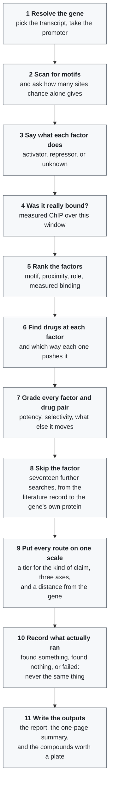

# generoutes

A Python research tool that collects ways an approved drug might raise or
lower one gene, from several independent kinds of evidence, and ranks them by
how strong that evidence is. It searches the gene's own product, the factors
recorded as regulating it, the compounds measured to move its protein, the
promoter's predicted binding sites, and ten other routes. Results are
hypotheses for further study, not validated treatment advice.

It was made for the Rare Disease, Real Kid: The MVA Hackathon 2026. The hackathon
asks the research community to help understand Mosaic Variegated Aneuploidy (MVA),
an ultra-rare genetic condition with no established treatment, through the genome and
clinical story of one child. Nothing here has been shown to help with MVA.

## The pipeline

One run, from a gene and a direction to ranked drug hypotheses, in the order the eleven stages happen. Stage 8 is where most of the searching is: the [detailed flowchart](docs/pipeline_detail.mmd) opens it out into all eighteen routes, and [how it works](docs/how-it-works.md) covers the data each one reads.



## The six steps between a gene and a protein

How much working protein a gene yields is set by six steps in series. A
report can fill two hundred rows about the first one and say nothing
about the other five without anything looking wrong, so every run opens
by auditing all six and marking each **searched**, **listed only** or
**not covered**.

| Step | What the run asks of it |
|---|---|
| Transcription | The promoter scan, the factor ligands, the recorded regulators, the upstream network, the literature record and the expression signatures. |
| Splicing and isoform choice | Exons used only by transcripts the cell destroys, each weighed by how much of the gene's message its isoforms carry in GTEx. |
| mRNA stability | AU-rich elements, Pumilio sites and the m6A consensus in the 3'UTR, each against a shuffle of the same sequence; the microRNAs and RNA-binding proteins named for this transcript by TargetScan, miRTarBase and ENCODE eCLIP; and measured methylation from REPIC. |
| Translation | Upstream ORFs in the 5'UTR with the Kozak strength of each, G-quadruplexes, and a 5'TOP motif at the cap. |
| Folding | A ligand screen against the gene's own protein, which is what a pharmacological chaperone would have to be. |
| Degradation | The ligase that destroys the protein, the enzyme that reverses it, and compounds measured on the protein itself. |

*Searched* means a gene-specific lookup ran and returned a count, and the
count may be zero — zero is then a result. *Listed only* means the
mechanism is named and nothing was looked up for this gene: a menu, not a
search. A full ranking is not evidence that the other steps were
considered, which is why the audit comes before the drug tables.

## Quick start

Requires Python 3.10 or later. From this checkout:

```sh
python -m venv .venv
```

Activate the environment (`.venv\Scripts\Activate.ps1` in PowerShell, or
`source .venv/bin/activate` on Linux/macOS), then run:

```sh
python -m pip install -e .
python -m generoutes --demo --gene DEMOGENE --out results/demo
```

The demo runs offline on synthetic data. Open `results/demo/report.md`.
The curated tables are part of the package, and `python -m generoutes.audit`
checks them ([what each holds](docs/curated-tables.md)).
A completed run also writes `results.json`, `tf_summary.tsv`, `sites.bed`,
and `promoter.fa`.

To analyze a real gene with live services, first fetch the reference files. Git
does not carry them, and the full set is about 4.5 GB (`--small` skips the largest;
`--list` shows what is missing):

```sh
python scripts/setup_data.py
python -m generoutes --gene CCR5 --direction down \
  --pfm-file data/jaspar2024.txt --chip-bed data/remap2022.bed.gz \
  --regulon-file data/chip_regulon.tsv --expression-file data/rna_tissue_consensus.tsv \
  --out results/CCR5_down
```

The table flags matter. With `--pfm-file` alone the run still works, but the
report loses the ChIP evidence and uses coarse regulon tiers. Read the
**Evidence available in this run** table at the top of `report.md` to see which
sources arrived. A report can still be marked degraded when the scan shows no
signal above chance, as it does for CCR5, and that is a property of the gene's
promoter window and not of the install. On Windows, `scripts\run_everything.bat` does both steps and
runs every stage.

To compare several candidate genes and narrow to the one with the least
collateral effect:

```sh
python -m generoutes.panel --genes GENE1,GENE2,GENE3 --control-gene ACTB --demo --out results/panel
```

Two things worth reading before acting on any output. Every report opens with
an **Evidence available in this run** table, because a run where the lookups
silently failed is otherwise structurally identical to one where they worked.
And the ranking is narrowed on four independent axes of collateral — how many
genes the factor controls, how body-wide it is, how many body systems the
drug moves, and whether a subtype-selective ligand can exist at all.

Saved example outputs, including a real run, are in [examples](examples/README.md).

The [command line guide](docs/cli-guide.md) says what you must type, what has a default and what each switch costs.

See the [documentation](docs/index.md) for installation details, input formats,
methods, limitations, the Python API, and development instructions —
in particular [specificity and evidence](docs/specificity.md) and
[comparing several genes](docs/panel.md).
