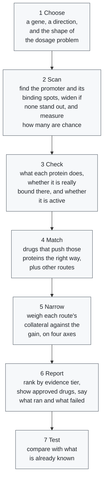

# promoter-tf-drugs

A Python research tool that collects ways an approved drug might raise or
lower one gene, from several independent kinds of evidence, and ranks them by
how strong that evidence is. It searches the gene's own product, the factors
recorded as regulating it, the compounds measured to move it, the promoter's
predicted binding sites, and nine other routes. Results are hypotheses for
further study, not validated treatment advice.

The package is named `promoter-tf-drugs` after the promoter motif route,
which was written first. That route is not the strongest one here and the
documentation no longer presents it as the method; see
[the routes](docs/how-it-works.md#the-routes-in-detail).

It was made for the Rare Disease, Real Kid: The MVA Hackathon 2026. The hackathon
asks the research community to help understand Mosaic Variegated Aneuploidy (MVA),
an ultra-rare genetic condition with no established treatment, through the genome and
clinical story of one child. Nothing here has been shown to help with MVA.

## The pipeline

One run, from a gene and a direction to ranked drug hypotheses. The [flowchart](docs/pipeline_detail.mmd) shows the same steps as a diagram, and [how it works](docs/how-it-works.md) covers the data each step reads.



## Quick start

Requires Python 3.10 or later. From this checkout:

```sh
python -m venv .venv
```

Activate the environment (`.venv\Scripts\Activate.ps1` in PowerShell, or
`source .venv/bin/activate` on Linux/macOS), then run:

```sh
python -m pip install -e .
python -m promoter_tf_drugs --demo --gene DEMOGENE --out results/demo
```

The demo runs offline on synthetic data. Open `results/demo/report.md`.
A completed run also writes `results.json`, `tf_summary.tsv`, `sites.bed`,
and `promoter.fa`.

To analyze a real gene with live services, first fetch the reference files. Git
does not carry them, and the full set is about 3 GB (`--small` skips the largest;
`--list` shows what is missing):

```sh
python scripts/setup_data.py
python -m promoter_tf_drugs --gene CCR5 --direction down --pfm-file data/jaspar2024.txt --out results/CCR5_down
```

On Windows, `scripts\run_everything.bat` does both and runs every stage.

To compare several candidate genes and narrow to the one with the least
collateral effect:

```sh
python -m promoter_tf_drugs.panel --genes GENE1,GENE2,GENE3 --control-gene ACTB --demo --out results/panel
```

Two things worth reading before acting on any output. Every report opens with
an **Evidence available in this run** table, because a run where the lookups
silently failed is otherwise structurally identical to one where they worked.
And the ranking is narrowed on four independent axes of collateral — how many
genes the factor controls, how body-wide it is, how many body systems the
drug moves, and whether a subtype-selective ligand can exist at all.

Saved example outputs, including a real run, are in [examples](examples/README.md).

The [command line guide](docs/cli-guide.md) says what you must type, what has a default and what each switch costs.

See the [documentation](docs/index.md) for installation details, input formats,
methods, limitations, the Python API, and development instructions —
in particular [specificity and evidence](docs/specificity.md) and
[comparing several genes](docs/panel.md).

## License

This repository is licensed under [Creative Commons Attribution 4.0 International](LICENSE) (CC BY 4.0). The public data sources it reads have their own terms; see [Setting up the data](docs/data-setup.md).
